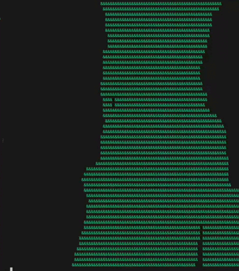
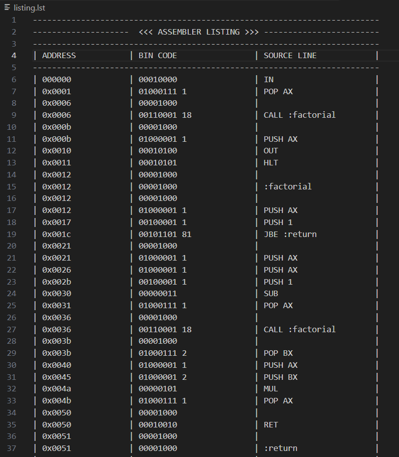

# VIRTUAL MACHINE

In this project I made custom assembler, which working with a language similar to real assembly language, and processor that executes byte code.
The processor is Turing-complete. As a part of the test, a program for calculating the factorial was written.
The virtual machine has its own RAM, and this project implements the ability to display graphical output to the console by printing the RAM.
For demonstrate the power of the processor, the "Bad apple" video clip is rendered in the console.

## Features

1. Uneven bytecode: the command is represented by 1 byte, in which the lower 5 bits specify the command code, and the last 3 bits indicate
   the presence of an argument - a constant, a register number, and a memory address in RAM. Arguments The arguments take up 4 bytes each.

**Some command**

| Command_byte | Argument_1 | Argument_2|
|  :---:   |   :---:   | :---: |            
| uint8_t  |  int32_t  |  int32_t  |

**Command_byte:**

|   7   |   6   |   5   |   4   |   3   |   2   |   1   |   0   |
|:---:|:---:|:---:|:---:|:---:|:---:|:---:|:---:|
| RAM   |  REG  | CONST |   0   |   0   |   0   |   0   |   0   |

2. The processor's possibility of graphical representation of RAM in the console. As an example, you can draw geometric shapes.
   I implemented the compilation and execution of bytecode that draws the "Bad apple" video in the console.

  

3. **Register and RAM addressing.** The `PUSH` and `POP` commands support several ways to access data:
   - a constant, for example `PUSH 10`;
   - a register, for example `PUSH AX`;
   - a RAM cell by absolute address, for example `PUSH [100]`;
   - a RAM cell by register address, for example `PUSH [BX]`;
   - an address calculated from a register and an offset, for example `PUSH [BX+30]`.

   The processor has five registers: `OX`, `AX`, `BX`, `CX` and `DX`. Register identifiers and constants are encoded in the instruction arguments, while the command byte stores the corresponding masks.

4. **Labels and control flow.** Labels can be declared with `:label`, and used by jump and function-call commands. Conditional jumps compare two values taken from the stack. The `CALL` and `RET` commands use a separate function stack to save and restore return addresses, which makes recursive functions possible.

5. **Stack-based arithmetic.** Arithmetic commands take their operands from the stack and push the result back. The implemented operations include addition, subtraction, multiplication,
   division and square root. The `IN` command reads a value from standard input, while `OUT` prints a value from the stack.

6. **Assembler listing.** The assembler can create a listing containing instruction addresses, encoded command bytes, arguments and the corresponding source lines.
   This is useful for checking how assembly instructions are translated into bytecode.


## Instruction set

There is some commands and their description

| Commands: | Description |
|:---|:---|
| `PUSH arg` | Push a constant, register value or RAM value onto the stack. |
| `POP arg` | Pop a value from the stack and write it to a register or RAM cell. |
| `ADD` | Add the top two stack values. |
| `SUB` | Subtract the top stack value from the value below it. |
| `SQRT` | Calculate the square root of the top stack value. |
| `IN` | Read a number from standard input and push it onto the stack. |
| `OUT` | Print and remove the top stack value. |
| `JUMP :label` | Jump to a label unconditionally. |
| `JA :label` | Jump if the first compared value is greater than the second. |
| `JAE :label` | Jump if the first compared value is greater than or equal to the second. |
| `JB :label` | Jump if the first compared value is less than the second. |
| `CALL :label` | Call a subroutine and save the return address. |
| `RET` | Return from a subroutine. |
| `HLT` | Stop program execution. |

## Bytecode format

Each instruction starts with one command byte. Its lower five bits contain the command code; the three upper bits are masks that describe the instruction's operands:

- `0x20` (`CONST`) — the instruction contains a 32-bit constant or offset.
- `0x40` (`REG`) — the instruction contains a 32-bit register identifier.
- `0x80` (`RAM`) — the operand refers to RAM.

Each encoded argument occupies four bytes (`int32_t`). If an instruction uses both a register and an offset, both arguments are stored after the command byte.
Instructions without arguments consist of the command byte alone. The exact operand interpretation depends on the combination of masks and the command.

## Usage

### 1. Assemble a program

Pass the assembly source file using `--asmsource` and choose the output bytecode file using `--bytecode`:

```bash
assembler --asmsource program.asm --bytecode bcode.bin
```

To additionally generate an assembler listing, add the `--listing` flag:

```bash
assembler --asmsource program.asm --bytecode bcode.bin --listing
```

The listing is written to `listing.asm`.

### 2. Run bytecode

Pass the resulting binary file to the processor with `--bytecode`:

```bash
processor --bytecode bcode.bin
```

The processor executes instructions until it encounters `HLT`. The `IN` and `OUT` commands use the console for input and output.

## Command-line flags

| Program | Flag | Meaning |
|:---|:---|:---|
| Assembler | `--asmsource file.asm` | Select the assembly source file. |
| Assembler | `--bytecode file.bin` | Select the output bytecode file. |
| Assembler | `--listing` | Write the assembly listing to `listing.asm`. |
| Processor | `--bytecode file.bin` | Select the bytecode file to execute. |

## Example

The following program reads a number and prints its factorial:

```asm
IN
POP AX

CALL :factorial

PUSH AX
OUT
HLT

:factorial

PUSH AX
PUSH 1
JBE :return

PUSH AX
PUSH AX
PUSH 1
SUB
POP AX

CALL :factorial

POP BX
PUSH AX
PUSH BX
MUL
POP AX

RET

:return
PUSH 1
POP AX

RET
```

## Debugging

The processor writes stack information to `dump.txt`. To enable instruction-by-instruction diagnostic output in the console, define `VMDump` during compilation.
The dump displays the stack, registers and bytecode around the current program counter.

The processor also contains a `DrawRam` function for displaying RAM contents as a console image. The RAM buffer contains 7000 cells; the drawing helper 
uses a 100 by 50 area. This makes RAM-based console graphics possible, including experiments such as rendering the *Bad Apple!!* video.
